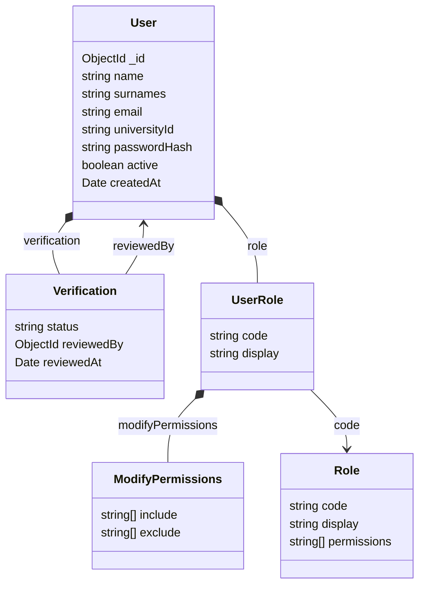

# Usuario

Representa a una persona que tiene una cuenta en el sistema.

## Propiedades

| Propiedad | Descripción | Restricciones |
|---|---|---|
| `_id` | Identificador de la cuenta en la base de datos | Único |
| `name` | Nombre de la persona | Obligatorio |
| `surnames` | Apellidos de la persona | Obligatorio |
| `email` | Correo electrónico utilizado para iniciar sesión | Obligatorio, único |
| `universityId` | Identificador universitario | Obligatorio, único |
| `passwordHash` | Hash de la contraseña de la cuenta | Obligatorio |
| `active` | Indica si la cuenta está activa | Obligatorio, booleano |
| `verification` | Información sobre el estado de verificación de la cuenta | Obligatorio |
| `role` | Rol asignado y ajustes de permisos específicos del usuario | Obligatorio |
| `createdAt` | Fecha y hora de creación de la cuenta | Obligatorio |

## Estructura de `verification`

| Propiedad | Descripción | Restricciones |
|---|---|---|
| `status` | Estado actual de verificación | `pending`, `verified`, `rejected` |
| `reviewedBy` | Usuario que tomó la decisión de verificación | Referencia a `users._id`; se omite mientras no haya una decisión |
| `reviewedAt` | Fecha y hora de la decisión de verificación | Se omite mientras no haya una decisión |

Cuando la cuenta todavía está pendiente de revisión, `verification` contiene únicamente `status: "pending"`. Los campos `reviewedBy` y `reviewedAt` se omiten.

Esta estructura conserva el estado y la decisión más recientes; el historial completo de decisiones todavía no está definido.

## Estructura de `role`

| Propiedad | Descripción | Restricciones |
|---|---|---|
| `code` | Código estable del rol asignado | Referencia a `roles.code` |
| `display` | Nombre legible del rol | Se copia en el usuario para facilitar su presentación |
| `modifyPermissions.include` | Permisos adicionales para este usuario | Lista de permisos |
| `modifyPermissions.exclude` | Permisos que se retiran de los permisos predeterminados del rol | Lista de permisos |

Los permisos predeterminados se definen en la colección `roles`. Los ajustes individuales se guardan en el usuario. Los permisos efectivos se calculan así:

`(permisos predeterminados del rol ∪ include) \ exclude`

Si un permiso aparece tanto en `include` como en `exclude`, prevalece `exclude`.

## Relaciones

- Un usuario puede crear incidencias.
- Un usuario puede comentar en incidencias.
- Un usuario puede recibir notificaciones.
- Un usuario puede ser responsable de una o más áreas.
- `verification.reviewedBy` referencia a otro usuario que revisó la cuenta.
- `role.code` referencia un rol de la colección `roles`.

Las incidencias, comentarios, notificaciones e historial pueden mantener referencias al usuario correspondiente. Las cuentas se desactivan mediante `active: false`; no se contempla eliminar físicamente usuarios, para preservar las referencias y el historial.

## Diagrama

## Notas

- Los nombres y apellidos no son únicos.
- `email` y `universityId` deben ser únicos.
- `passwordHash` almacena el hash, nunca la contraseña en texto plano.
- `active` y `verification.status` representan conceptos distintos: una cuenta puede estar desactivada sin que cambie su estado de verificación.
- El rol contiene un `code` estable y un `display` legible. 
- Las reglas de acceso para cuentas inactivas o todavía no verificadas están pendientes de definir.
- La política posterior a un rechazo de verificación está pendiente de definir.
- El modelo de permisos describe la estructura de datos; la política completa de autorización y las reglas de negocio deben documentarse por separado.
