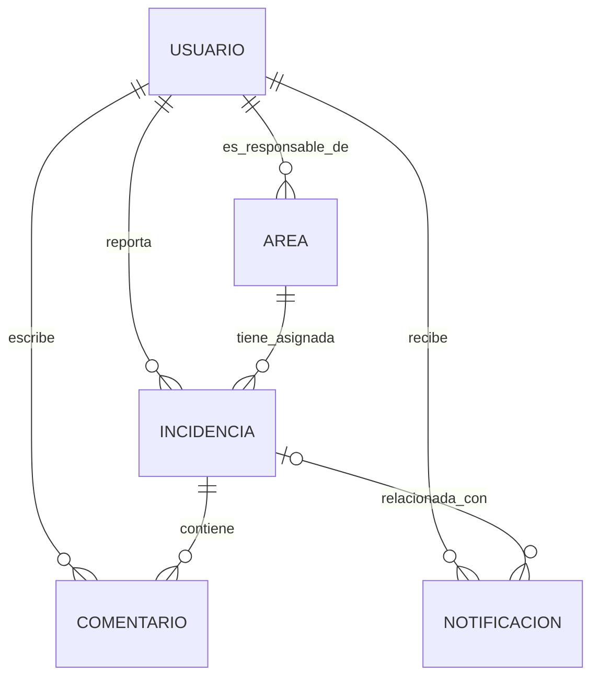

# Modelo conceptual del dominio

## 1. Propósito

Este documento describe las principales entidades del dominio de Pa-Cuando y las relaciones entre ellas.

Su objetivo es establecer un entendimiento común del negocio antes de definir el modelo de datos y la implementación.

Este documento no define campos, estructuras de MongoDB ni detalles técnicos de implementación.

El modelo es provisional y se actualizará conforme se aclaren los requisitos del sistema.

## 2. Entidades

### Usuario

Representa a una persona que utiliza el sistema.

El acceso a las funcionalidades del sistema depende del estado de verificación de la cuenta y de los permisos que tenga el usuario para realizar cada operación.

### Área

Representa un área de la universidad a la que pueden asignarse incidencias.

Cada área tiene exactamente una persona responsable de su gestión. Esta responsabilidad puede cambiar con el tiempo.

### Incidencia

Representa un problema reportado dentro de la universidad.

Tiene una persona propietaria que la reporta y un área responsable de su gestión. Su ciclo de vida incluye cambios de estado y puede incluir reasignaciones entre áreas.

### Comentario

Representa una comunicación asociada a una incidencia.

Permite que las personas involucradas en su gestión intercambien información sobre el problema.

### Notificación

Representa un aviso dirigido a un usuario como consecuencia de un acontecimiento relevante del sistema.

Las notificaciones se consultan desde una bandeja de entrada y pueden marcarse como leídas. Entre los acontecimientos que pueden generarlas están los comentarios, los cambios de estado, las reasignaciones y la resolución de una incidencia.

## 3. Relaciones entre entidades

